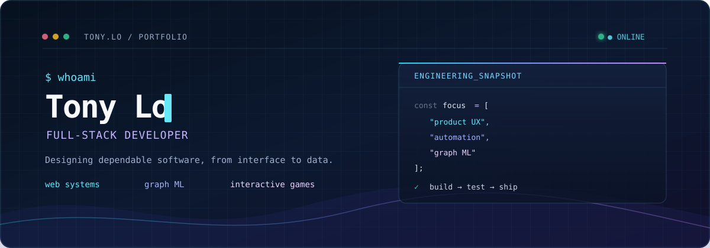

## 👋 About

I'm **Tony Lo**, a Computer Science graduate from **Auburn University**. I build polished, end-to-end software: responsive interfaces, dependable data-backed services, test automation, graph-based ML experiments, and interactive games.

- 🎓 **B.S. Computer Science** — Auburn University (Class of 2026)
- 🌐 **Product engineering** — React, Node.js, Firebase, PHP, MySQL
- 📊 **Applied ML** — graph feature engineering and from-scratch k-NN evaluation
- 🎮 **Interactive development** — Unity3D and HTML5 Canvas
- 🌍 **Trilingual** — English · Mandarin · Cantonese

 

## 🛠️ Tech Stack

**Languages**

**Frameworks & Libraries**

**Tools & Platforms**

 

## 🚀 Featured Projects

<table>
<tr>
<td width="50%">

### 🐟 [Fish Life Adventure](https://github.com/tonylodev/fish-life-adventure)
**HTML5 Canvas · JavaScript**

An educational aquarium game about oxygen, health, and pollution. Built with a canvas game loop, collision detection, and a state machine, with responsive keyboard/touch controls and a text status display.

🎮 [**Play it live →**](https://tonylodev.github.io/fish-life-adventure/)

[Game implementation](https://github.com/tonylodev/fish-life-adventure/blob/main/index.html)

</td>
<td width="50%">

### 🔍 [HN Sort Validator](https://github.com/tonylodev/hn-sort-validator)
**Playwright · Node.js · Automated Testing**

Checks that 100 unique Hacker News articles are newest-to-oldest and writes an HTML report. Handles rate limits, duplicate items, and stalled pagination; incomplete collection fails the run.

[Unit tests and CI](https://github.com/tonylodev/hn-sort-validator/actions/workflows/test.yml) · [Local Chromium fixture tests](https://github.com/tonylodev/hn-sort-validator/blob/main/integration/scraper.browser.cjs)

</td>
</tr>
<tr>
<td width="50%">

### 📊 [k-NN Graph Classifier](https://github.com/tonylodev/knn-graph-classifier)
**Python · NetworkX · NumPy · Matplotlib**

From-scratch k-NN and F1 metrics on a real collaboration graph, with five-fold stratification, normalization fit on each training fold, and a majority-class baseline. Predicts a synthetic degree-based label using full-graph features (transductive evaluation).

[Results and evaluation limits](https://github.com/tonylodev/knn-graph-classifier#-results) · [Regression tests](https://github.com/tonylodev/knn-graph-classifier/blob/main/tests/test_knn_classifier.py)

</td>
<td width="50%">

### 📚 [Bookstore Database](https://github.com/tonylodev/bookstore-database)
**MySQL · PHP · HTML**

Seven related MySQL tables, fictional demo data, and 19 SQL examples from filtering to multi-table reporting. The read-only PHP interface handles query failures and nullable results; MySQL CI checks the schema, seed data, and queries.

[Database CI](https://github.com/tonylodev/bookstore-database/actions/workflows/database.yml) · [Local PHP controller tests](https://github.com/tonylodev/bookstore-database/blob/main/tests/interface_test.php)

</td>
</tr>
</table>

 

## 🤝 Let's Connect

 

Open to software engineering opportunities · Let’s build something useful.

